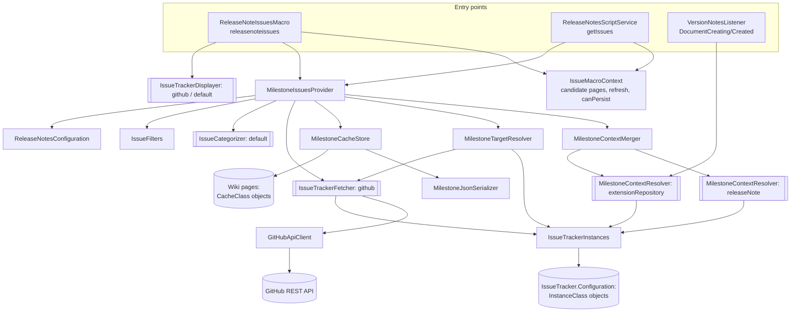
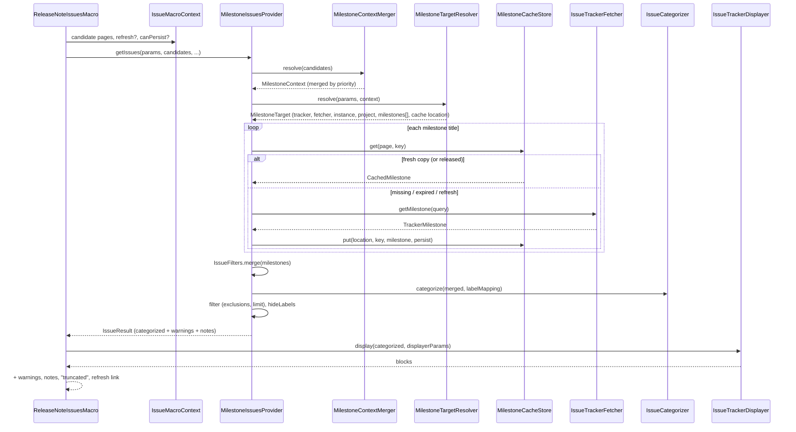

# Issue Tracker Integration: Architecture

This document describes how the issue tracker integration (`{{releasenoteissues/}}`) is built: the components, how
a request flows through them, where data is stored, and where the extension points are. For *using* the macro and
adding a tracker step by step, see `document.md`; for the original requirements, see `task.md`.

## 1. Overview

A page (a release note of this application, a version of an Extension Repository extension, or any page) displays
the issues of one or more tracker milestones, grouped into **Bugs / New Features / Improvements / Other**.

The design rests on four pluggable XWiki component roles, each selected by a hint:

| Role                       | Question it answers                                   | Implementations (hint)                                     |
|----------------------------|-------------------------------------------------------|------------------------------------------------------------|
| `MilestoneContextResolver` | What can the current page tell about the milestone?   | `releaseNote` (prio 100), `extensionRepository` (prio 200) |
| `IssueTrackerFetcher`      | How do I get a milestone and its issues from tracker X? | `github`                                                   |
| `IssueCategorizer`         | Which category does each issue go in?                 | `default` (label based)                                    |
| `IssueTrackerDisplayer`    | How are the issues of tracker X rendered?             | `github`, `default` (fallback)                             |

Everything else is internal plumbing that composes these roles: parameter/context merging, a two-tier cache,
tracker instance configuration (credentials), and a listener that auto-inserts the macro into imported versions.

The model **reuses the existing release notes model**: an issue is an `IssueChange extends Change`, a milestone is a
`TrackerMilestone extends ReleaseNote`, and the cache for a release note lives in an `Issues` child page marked with
an `EntryClass` object, exactly like the existing `Contributors` page.

## 2. Code placement

```
application-releasenotes-api
└─ org.xwiki.contrib.releasenotes
   ├─ ReleaseNotesConfiguration              (+6 issue* getters, non-secret wiki settings)
   ├─ internal/ReleaseNotesReferences        (+IssueTracker space references)
   ├─ internal/ReleaseNotesDocumentWriter    (+minor-edit save)
   ├─ script/ReleaseNotesScriptService       (+getIssues(Map))
   └─ tracker/                               PUBLIC API (@Unstable, @since 2.8)
      ├─ roles:      IssueTrackerFetcher, IssueTrackerDisplayer, IssueCategorizer, MilestoneContextResolver
      ├─ model:      TrackerMilestone, IssueChange, CategorizedMilestone, IssueCategory,
      │              MilestoneQuery, MilestoneContext, LabelMapping, IssueDisplayerParameters
      ├─ exceptions: IssueTrackerException ─┬─ MilestoneNotFoundException
      │                                     ├─ TrackerAuthenticationException
      │                                     └─ RateLimitExceededException
      │              IssueDisplayerException
      └─ internal/                          IMPLEMENTATION
         ├─ macro:        ReleaseNoteIssuesMacro, ReleaseNoteIssuesMacroParameters, IssueMacroContext
         ├─ pipeline:     MilestoneIssuesProvider, MilestoneContextMerger, MilestoneTargetResolver,
         │                MilestoneTarget, IssueResult, IssueFilters, IssueRequestException
         ├─ resolvers:    ReleaseNoteMilestoneContextResolver, ExtensionRepositoryMilestoneContextResolver
         ├─ cache:        MilestoneCacheStore, CachedMilestone, CacheLocation, MilestoneJsonSerializer
         ├─ config:       IssueTrackerInstances, TrackerInstance
         ├─ categorizing: DefaultIssueCategorizer
         ├─ rendering:    AbstractIssueTrackerDisplayer, DefaultIssueTrackerDisplayer, IssueBlocks, IssueTranslator
         ├─ listener:     VersionNotesListener
         └─ github/       GitHubIssueTrackerFetcher, GitHubApiClient, GitHubIssueTrackerDisplayer, GitHubProperties

application-releasenotes-ui   ReleaseNotes/Code/IssueTracker/
   ├─ Configuration.xml   tracker instances (admin-only rights; holds tokens)
   ├─ InstanceClass.xml   XClass of a tracker instance
   ├─ CacheClass.xml      XClass of a cached milestone
   ├─ IssueStyle.xml      SSX used by the displayers
   └─ Documentation.xml   macro documentation page
   ReleaseNotes/Code/ReleaseNotesConfig(Class).xml   +6 issue* settings
   ReleaseNotes/Code/Translations.xml                +releasenotes.issues.* keys
```

All components are registered in `application-releasenotes-api/src/main/resources/META-INF/components.txt`.

## 3. Component diagram



`[[...]]` marks a component role (extension point); the others are internal singletons.

## 4. Request pipeline

A macro execution goes through the following steps (`ReleaseNoteIssuesMacro.execute` →
`MilestoneIssuesProvider.getIssues`):



### 4.1 Candidate pages (`IssueMacroContext`)

The macro content does not always belong to the viewed page (e.g. the versions Live Data renders each row with its
own version page). Candidates are, in order: the **secure document** (`sdoc`, the page owning the content), then the
**viewed page** if different. `MilestoneContextMerger` uses the first candidate that any resolver recognizes.

### 4.2 Context resolution and parameter precedence

Every `MilestoneContextResolver` is asked for the candidate page; answers are merged with
`MilestoneContext.fillFrom` (first non-null wins, lowest priority number first). Then `MilestoneTargetResolver`
applies the macro parameters on top:

```
macro parameter  >  releaseNote resolver (100)  >  extensionRepository resolver (200)  >  error
```

Rules worth knowing:

- `project` and `configuration` inferred from the page are only used when the page's tracker **equals** the tracker
  being used (a page's GitHub project is meaningless for another tracker).
- Milestone titles come from the `milestone` parameter, or from the context's `versions` passed through
  `milestonePattern` (`{version}`, `{product}`, and resolver-provided placeholders such as `{id}`, `{artifactId}`).
- Missing tracker/project/milestone, unknown tracker hint, or unknown configuration id raise
  `IssueRequestException`, which carries a translation key telling the page author what to fix.

**`releaseNote` resolver**: reads the `ReleaseNote` of the page; product → tracker instance via the instance's
`products` map (`product = owner/repo`); versions = aggregated versions of the release note (like-patterns such as
`1.5-rc-%` are expanded against existing release notes and sorted, so a final release shows its RC/milestone issues
too); cache page = `<note>/Issues/WebHome`; `released` = note is released.

**`extensionRepository` resolver**: reads Extension Repository objects **by class name** (no compile-time dependency
on the repository). Version from the single version object (several → `unresolvedReason = severalVersions`); tracker
from `issueManagementSystem` via the configurable system aliases; project from the first issue-management / source /
SCM address whose host matches a configured (or public GitHub) instance. An extension naming an unknown issue system
(e.g. JIRA) is deliberately *not* guessed from its GitHub source URL.

### 4.3 Merging, categorizing, filtering

- **Merge** (`IssueFilters.merge`): several milestones (final + RCs) become one `TrackerMilestone`; numeric
  properties are summed, dates take earliest/latest.
- **Label mapping**, layered key by key (`LabelMapping.override`):

  ```
  LabelMapping.getDefault()  <  wiki config (issueLabelMapping)  <  tracker instance  <  macro parameter
  ```

  A mapping assigns category (`bug`, `feature`, `improvement`) and optionally `importance.*` / `audience.*`.
- **Categorize** (`DefaultIssueCategorizer`): works on *copies* of the issues (the cached milestone is shared and
  must never be mutated). Precedence Bug > Feature > Improvement > Other; sorted by issue id.
- **Filter**: exclusions (`#123` ids), per-category `limit` (tracked via `CategorizedMilestone.getTotal/isTruncated`),
  hidden label regexes (wiki + parameter; invalid regexes become warnings, not failures).

### 4.4 Displaying

```
IssueTrackerDisplayer (role)
└─ AbstractIssueTrackerDisplayer         layouts: list, summary, table; category headings; SSX IssueStyle
   ├─ DefaultIssueTrackerDisplayer  "default"   [id] title, columns ID/Title/State/Assignees
   └─ GitHubIssueTrackerDisplayer   "github"    #123 links, PR marker, colored label chips, people, milestone header
```

Displayer selection: explicit `displayer` parameter → displayer with the tracker's hint → `default`. A subclass only
implements `displayEntry(issue)` and `getTableColumns()`, optionally `displayHeader(milestone)`.

Tracker-specific data travels in `IssueChange.getProperties()` / `TrackerMilestone.getProperties()` (JSON-safe
values only, so it survives the cache). The fetcher and displayer of one tracker agree on the property names
(`GitHubProperties`); a displayer must tolerate missing properties (older cache entries).

Default layout is `list`, except in a Live Data table (`get` action) where it is the configured
`issueRepositoryLayout` (default `summary`).

## 5. Caching

Two tiers, managed by `MilestoneCacheStore`:

| Tier   | Where                                                          | Purpose                                    |
|--------|----------------------------------------------------------------|--------------------------------------------|
| Memory | XWiki LRU cache `releasenotes.issues`, 500 entries             | shared across readers, avoids JSON parsing |
| Page   | `ReleaseNotes.Code.IssueTracker.CacheClass` objects on a page  | survives restarts                          |

- **Key**: `tracker|configurationId|project|milestone|includePullRequests`; memory key is prefixed by the page
  reference. One `CacheClass` object per key (fields `cacheKey`, `data` JSON, `fetchDate`, `milestoneState`).
- **Location** (`CacheLocation`): the resolver's cache page (release notes: hidden `Issues` child page created with an
  `EntryClass` of type `Issues`), otherwise the page owning the macro content.
- **Expiry** (`CachedMilestone.isExpired`): a closed milestone never expires; an open one expires after
  `cacheDuration` parameter or wiki `issueCacheDuration` (default 60 min). A page marked `released` never refetches.
- **Stale fallback**: if a refetch fails (network, auth, rate limit — not "not found"), the old copy is shown with a
  `staleCache` warning.
- **Refresh**: `?releasenoteissues_refresh=1&form_token=…`, honored only with edit right and a valid CSRF token.
- **Persisting** happens only when *all* hold: not a restricted context, action is `view`/`get`, the viewed page is
  the content-owning page (not included/previewed/exported), the current user has edit right on the cache page, and
  the JSON actually changed. Saves are minor edits. Otherwise the result is kept in memory only.
- **Serialization** (`MilestoneJsonSerializer`) writes fields explicitly rather than bean-mapping, so the cache format
  does not shift when getters are added.

## 6. Configuration and credentials

Two separate stores, split on purpose by sensitivity:

| Setting                                                                       | Stored in                                              | Read by                        |
|-------------------------------------------------------------------------------|--------------------------------------------------------|--------------------------------|
| cache duration, label mapping, repository layout, system aliases, auto-fill, hidden labels | `ReleaseNotesConfigClass` on `ReleaseNotesConfig` (normal admin section) | `ReleaseNotesConfiguration`    |
| tracker instances: id, tracker, products, API/web URL, **tokens**, default flag, label mapping, timeouts | `InstanceClass` objects on `IssueTracker.Configuration` (admin-only view rights) | `IssueTrackerInstances` |

`IssueTrackerInstances` reads the configuration page **without** checking rights (readers must be able to see issues
without seeing tokens). `TrackerInstance` therefore stays internal, is never handed to scripts, and has no
`toString()`. When no instance is configured for a tracker, a **public instance** (anonymous `api.github.com`) is
synthesized, so public GitHub repositories work out of the box.

Instance lookup: by explicit id → the tracker's default instance → its first instance → public instance. Also by
product (`releaseNote` resolver) and by web host (`extensionRepository` resolver).

## 7. GitHub implementation

- `GitHubIssueTrackerFetcher` validates `owner/repo`, finds the milestone by title among
  `/repos/{repo}/milestones?state=all`, then pages `/repos/{repo}/issues?milestone=N&state=all&per_page=100`;
  pull requests are dropped unless `includePullRequests`. HTTP clients are cached per connection timeout.
- `GitHubApiClient` (plain class, one per fetch): follows `Link: rel="next"` pagination; maps 401 to `TrackerAuthenticationException`
  and 429 / rate-limited 403 to `RateLimitExceededException` (with reset date); reports 404 by returning `false`
  from `readAll`, which the fetcher turns into `MilestoneNotFoundException` (unknown repository or milestone title);
  **fails over** to the next configured token on rejection or rate limit (for expired/revoked tokens, not pooling);
  does **not follow redirects**, so a token can only go to the configured base URL; never logs or throws tokens.

## 8. Extension Repository auto-fill (`VersionNotesListener`)

Listens to `DocumentCreatingEvent` and `DocumentCreatedEvent`:

- **Version page being created** under an existing extension → fill its `notes` with `{{releasenoteissues/}}` in the
  same save.
- **Extension page created** (first import creates versions *before* the extension page) → query
  `<extension>.Versions.%` pages and fill each, one minor save each.

A version is filled only if: auto-fill is enabled, the page has exactly one version object, its notes are empty, and
the `extensionRepository` resolver can infer tracker + project + version. Failures are logged and never break the
import. Only creations are watched, so an author who empties notes later keeps them empty.

## 9. Security model (summary)

| Concern                                  | Mitigation                                                                                      |
|------------------------------------------|-------------------------------------------------------------------------------------------------|
| Page author exfiltrating tokens          | Tracker URL and tokens come only from admin-configured instances, never from macro parameters; no redirects followed |
| Tokens leaking to readers/logs           | Internal-only `TrackerInstance`, no `toString()`, sanitized exception messages, admin-only config page |
| Wiki-syntax injection from tracker data  | Displayers build `Block`s directly (`IssueBlocks.text`), never parse tracker text; links only to http(s) |
| Cache writes by unprivileged viewers     | Save only with edit right, in `view`/`get`, non-restricted, on the owning page                  |
| Forced refetch / DoS via refresh         | Refresh needs edit right + CSRF token                                                           |
| Shared cached objects mutated per page   | Categorizer copies issues; cached milestone treated as immutable                               |

## 10. Error handling

`IssueTrackerException` and `IssueDisplayerException` are caught in the macro and rendered as an error box (or a
compact line in `summary`) via `IssueTranslator.describe`, which translates `IssueRequestException` keys and never
exposes credentials or stack traces. Among several milestones, one missing milestone is skipped with an info note;
if all are missing, or the only one is, it is an error.

## 11. Extending

**New tracker** (e.g. OpenProject): implement `IssueTrackerFetcher` with hint `openproject` (read URL/tokens from
`IssueTrackerInstances.getInstance("openproject", query.getConfigurationId())`), optionally an
`IssueTrackerDisplayer` with the same hint extending `AbstractIssueTrackerDisplayer`, register both in
`components.txt`, and add a system alias if Extension Repository pages should map to it. See `document.md` §4.

**New page type** that should infer milestones: implement `MilestoneContextResolver` with a priority.

**Different categorization**: implement `IssueCategorizer` (note: `MilestoneIssuesProvider` currently injects the
`default` hint only).

## 12. Changes to pre-existing code

- `ReleaseNotesConfiguration` / `DefaultReleaseNotesConfiguration`: six `issue*` getters (revapi exclusions added in
  `application-releasenotes-api/pom.xml`, justified by the role being `@Unstable`).
- `ReleaseNotesReferences`: `IssueTracker` space and its class/page references; `childSpace()` helper.
- `ReleaseNotesDocumentWriter`: `save(document, comment, minorEdit)` overload.
- `ReleaseNotesScriptService`: `getIssues(Map)` → `CategorizedMilestone` (never persists, never refreshes).
- `application-releasenotes-api/pom.xml`: rendering API/macro transformation, Jackson, cache API, skin API, CSRF;
  rendering test dependencies.
- UI: `ReleaseNotesConfigClass`/`ReleaseNotesConfig` (issue settings section), `Translations` (`releasenotes.issues.*`),
  `EntryClass` (new `Issues` entry type), `RequiredRightsTest` (new pages).

## 13. Open points noticed while documenting

- **Version mismatch**: the POMs were bumped from `2.8-SNAPSHOT` to `2.14-SNAPSHOT`, while every new class says
  `@since 2.8`. One of the two should be aligned before merging.
- **Rendering tests are missing**: `tracker/internal/IntegrationTests` runs `releasenoteissues*.test` files, but no
  `.test` file exists under `src/test/resources`, so the macro/displayer output is currently untested. Only
  `VersionNotesListenerTest` and `IssueFiltersHiddenLabelsTest` exercise the new code; the GitHub fetcher, cache
  store, resolvers and categorizer have no unit tests.
- **Memory cache invalidation**: the in-memory tier is not invalidated when a `CacheClass` object is edited or
  deleted by hand; the old entry is served until LRU eviction, expiry, a refresh, or a restart.
- **Saving during rendering** (`task.md` §11.3): the page save happens inside a view request. It is minimized (only
  on change, minor edit, right after reload) but still adds a history entry and can race with concurrent edits.
- **Categorizer hint**: only the `default` `IssueCategorizer` is injected; there is no parameter to pick another one.
